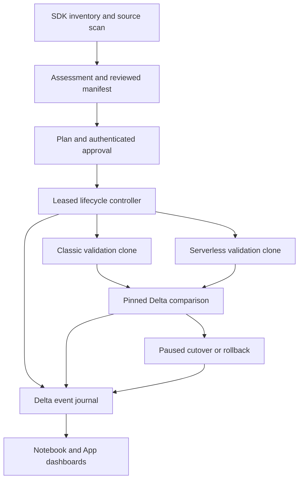

# Architecture

The unit of migration is a workload in a named programme. Inventory answers what exists; programme state answers what has been reviewed, executed and verified. They are joined by the source job ID, while previous programme attempts remain visible in the audit history.

## Components

| Component | Responsibility |
|---|---|
| `discovery.py`, `static_scan.py`, `assessment.py` | Permission-scoped inventory, explicit Jobs array pagination, source export and deterministic findings |
| `remediation.py` | Bounded script retrieval, strict dependency translation, reviewable AST/SQL edits and JAR packaging |
| `orchestration.py` | Shared direct serverless compiler; dependency validation and trigger removal |
| `program.py` | State transitions, configuration-bound approval, snapshots and evidence binding |
| `fleet.py`, `program_runtime.py` | Manifest contracts, classic/serverless clone creation, idempotent submission, wave throttling and execution observation |
| `lease.py`, `delta_journal.py` | Cooperative exclusive controller lease; append-only state-plus-audit revisions |
| `ab.py`, `validation.py` | Distributed pinned-table comparison and bounded/local record comparison |
| `cost.py` | Workspace-scoped, correction-aware run attribution and effective list pricing |
| `reconcile.py`, `promotion.py` | Atomic Bundle writeback, staged original-ID cutover, activation and rollback |
| `evidence.py`, `notebook_dashboard.py` | Shared persisted reader, fleet/programme join and escaped HTML view |

## State and identity

`program_events` has a composite logical identity `(program_id, workload_id, sequence)`. An appended row contains the authenticated actor, event type/time, complete state snapshot and event details. State and its audit record are one Delta append. Reads reject duplicate revisions, gaps and mismatched event/snapshot identities.

The general controller acquires a lease by updating one existing Delta row conditionally. Delta transaction conflicts serialize acquisition. It renews before journal writes and mutating REST requests. Expired/non-owned leases stop writes. The legacy synthetic demo remains single-writer; it is not retroactively described as using the new lease.

A single Bundle controller run is also enforced with `max_concurrent_runs=1`. The lease coordinates interactive controller invocations too. UC write privileges must be restricted: this is a cooperative control plane, not tamper-proof storage against an administrator.

SDK identity must match SQL `current_user`. The runner derives administrator status from the authenticated principal's groups; it is not a widget. A stored approval binds the source, candidate, classic validation definition, production proposal, notebook hashes, input snapshot and manifest. Literal credential-like settings are refused before durable backups.

## Execution model

The manifest is the workload's I/O contract. It declares an immutable input table/version, parameter names, task-input dependencies, final output task, ignored/key columns and wave. Planning gives classic and serverless runs independent output namespaces. Automatic execution is limited to notebook tasks that obey this reviewed contract.

The classic baseline is an unscheduled validation clone retaining classic compute and libraries. The source job is not run. A successful bound classic run and immutable output version must exist before serverless submission. Both requests use durable idempotency tokens. Exact identity tags allow job recovery if creation succeeds before the corresponding event is committed; duplicate matches stop recovery.

The general runner's main path is:

`ASSESSED → PLANNED → APPROVED → classic baseline execution → CLONED → EXECUTION_REQUESTED → EXECUTING → EXECUTED → VALIDATED`

Failures are explicit. `KEEP_CLASSIC` and `DEFERRED` are administrator decisions before execution. Validation failure is not a migrated workload. Synthetic baselines cannot authorize cutover.

Bulk execution advances a selected wave without waiting for all Jobs to finish. It limits inflight workloads, enables Jobs queueing and checks cross-workload validation dependencies. A task DAG is never split by an arbitrary task count.

## Validation and billing

Distributed comparison uses Spark SQL equality semantics and `EXCEPT ALL` in both directions. It preserves duplicate multiplicity without collecting the complete data into Python. It compares sorted typed schemas, row counts, null counts, duplicate-key groups and changed-key groups. Schema mismatch produces FAIL; unsupported set-operation types produce an error rather than PASS.

Pinned Delta versions bind the historical outputs to the recorded run. Ignored columns are explicit and cannot overlap keys. The older local/warehouse comparison remains bounded and fails on cap overflow; it is not used as a sample-based full-table claim.

Billing is independently observed and can lag execution. Signed billing quantities retain corrections. Price matching uses SKU, cloud, unit, USD currency and effective interval; missing, overlapping or boundary-spanning prices cannot become fabricated totals. Savings are shown only for successful matching outputs and complete positive attributed usage. USD list cost excludes discounts and external cloud infrastructure.

## Cutover, rollback and repository state

Cutover requires genuine classic/serverless PASS evidence, fresh code/configuration digests, matching successful Jobs runs, a verified source backup, no active related runs, trigger-free validation clones and verified Bundle writeback. It first pauses source triggers, verifies related runs have drained, then resets the original job ID to the serverless configuration with triggers paused. Activation restores the original trigger policy separately.

Rollback verifies the current migrated digest and backup, restores the classic Bundle resource and resets the original ID with triggers paused. It also uses a separate activation action. Neither transition silently overwrites third-party changes. A notebook code edit blocks these actions: a configuration backup cannot restore externally edited code.

Generated Bundle resources omit triggers and require an explicit bind to manage the original ID. Runtime activation records the resulting trigger-policy reconciliation requirement before another Bundle deployment. The system claims file writeback and drift detection, not an external Git commit/review or a deployment it did not perform.

## Failure handling

| Failure | Behaviour |
|---|---|
| Inventory permission/cap failure | Partial scan with errors; no false completeness |
| Unsupported task/script/library/code | Planning blocked, review proposal or keep-classic decision |
| Source, code or approved-contract drift | Stop before execution/cutover |
| Duplicate job identity or journal revision | Stop and reconcile |
| Crash after create/run submission | Recover by exact tags/idempotency token |
| Failed classic baseline | Record failure; do not launch target |
| Schema/record difference | Persist validation FAIL; no cutover |
| Missing billing or prices | Pending/incomplete; no savings percentage |
| Crash after cutover reset | Verify live readback before completing the saved request |
| Active runs or clone triggers | Block cutover, rollback or activation |
| Rollback backup/file drift | Stop; do not overwrite current state |

## Deployment boundary

The Bundle includes the controller, acceptance/scan/validation/dashboard jobs and App definition. `scripts/deploy.sh` is the authenticated validation/deployment entry point. Local CLI schema checks do not prove entitlement, UC grants or live deployment.

Free Edition and Express serverless workspaces cannot execute the classic side. The serverless acceptance notebook and earlier live demo are useful evidence there; a genuine classic A/B test still requires an authorized classic-capable sandbox. The older SQLite CLI is a separate local exploration path, not a second synchronized source of truth.
