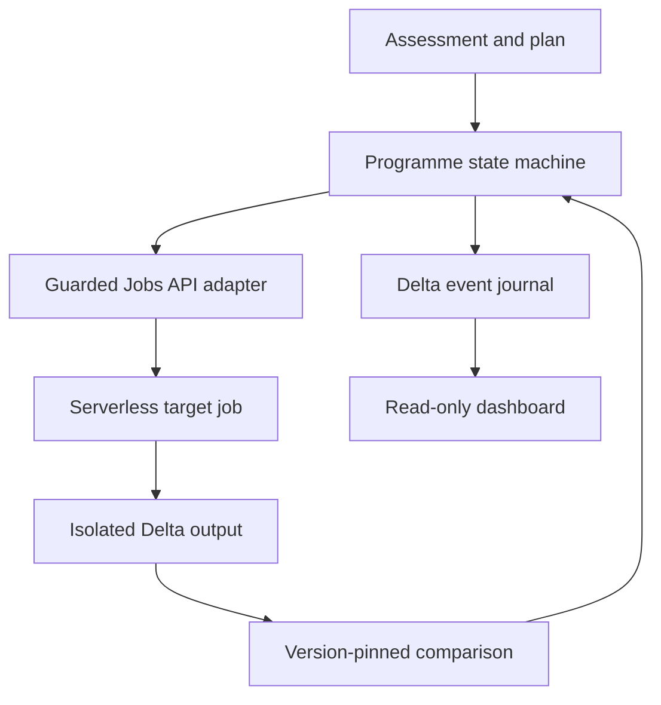

# Architecture

## Problem and scope

A per-job migration assistant does not give a platform owner a fleet inventory, an approval history or evidence that the output still matches. This project supplies those controls around a narrow, supported migration path.

The main demonstration uses imported classic job definitions and synthetic baseline data. It creates and executes a real serverless target. It does not claim to have run classic compute or completed production cutover.

## Components

The notebook runner coordinates these steps. The arrows show the lifecycle, rather than Python import dependencies.

| Component | Responsibility | Boundary |
|---|---|---|
| `assessment.py`, `discovery.py` | Inventory, findings, readiness and workload references | Read-only workspace calls; incomplete scans carry warnings |
| `orchestration.py` | Build supported serverless candidates and validate task graphs | Pure planning; unsupported configuration fails closed |
| `program.py` | State transitions, approval binding and evidence requirements | No direct Spark or Jobs calls; receives a journal through a small protocol |
| `delta_journal.py` | Append state/audit revisions and recover the current state | One serialized writer per programme; no distributed lock |
| `program_runtime.py` | Create/recover clones, submit runs and inspect run state | Uses approved payloads and Jobs API identifiers |
| `validation.py` | Exact schema and record comparison | Does not execute jobs or infer business equivalence |
| `notebook_dashboard.py` | Render saved inventory, programme states and evidence | Read-only; does not authorize or perform cutover |

The local CLI predates the Delta programme and uses SQLite. It remains useful for offline examples and narrow sandbox operations. It is a separate deployment mode, not a replica of the Delta state. Do not treat both stores as authoritative for the same workload.

## State and identity

The journal key is `(program_id, workload_id, sequence)`. Each row stores the resulting state, event type, actor, time and details in one Delta commit. A recovered history must have contiguous revisions, matching snapshot identifiers and a recognized state schema. Duplicate or inconsistent histories stop further work.

Normal progress is:

`READY → PLANNED → APPROVED → CLONE_REQUESTED → CLONED → EXECUTION_REQUESTED → EXECUTING → EXECUTED → VALIDATED`

Assessment blockers and execution/validation failures remain explicit states. The 11-task example may move from an agent-limit blocker to a direct-API plan, but the demo does not execute it.

The notebook checks that SQL `current_user()` agrees with the SDK principal. Approval records that identity and its scope. A workspace-admin indication comes from the principal's groups. Otherwise, self-approval is limited to the authenticated owner of a synthetic fixture. The Python API trusts its caller to supply identity; it is not an external authorization service.

`VALIDATED` means the recorded output comparison passed. It does not mean `MIGRATED`, and the programme never enables production triggers.

## Decisions

| Decision | Reason | Tradeoff |
|---|---|---|
| Delta history for the workspace route | State and supporting evidence stay in Unity Catalog; no external database is needed for the demo | Revisions are append-only snapshots; the implementation assumes a serialized runner |
| Fingerprint source and candidate before approval | Approval must refer to the configuration actually reviewed, including programme tags | A changed plan needs a new review; fingerprints are not immutable artifact packaging |
| Keep a large job's dependency graph intact | The migration agent's task cap does not require splitting a supported Jobs API job | The guarded direct path is capped at 100 tasks and rejects unsupported settings |
| Remove all clone triggers | A validation copy must not compete with the original schedule | Promotion and schedule handover remain manual |
| Bind Delta versions | Later table writes must not change the data being compared | Time travel needs retained table history and does not cover external side effects |
| Compare record multisets | Row ordering is irrelevant; duplicate multiplicity is not | Exact matching needs bounded data; tolerance/business rules need a separate policy |
| Fail closed on uncertain configuration | An explainable refusal is preferable to stripping a setting silently | The automatic path supports fewer workloads |

## Failure handling

| Interruption or error | Behaviour |
|---|---|
| Before clone creation | Approval and the source backup must already be in the journal |
| Create succeeds but the response/state write is lost | Recovery searches the exact programme/workload tags, verifies the candidate and rejects multiple matches |
| Run request is interrupted | Retry uses the same Jobs idempotency token |
| Clone changes after readback | Its stored digest no longer matches; execution/validation is refused |
| Job fails | The run ID and failure state remain available; no validation success is recorded |
| Comparison differs | Record `VALIDATION_FAILED`; leave cutover blocked |
| Negative control unexpectedly passes | Refuse to record it as a detected failure |
| Journal has gaps, duplicates or an unknown schema | Stop and reconcile; do not guess a current state |
| Billing is unavailable or delayed | Record availability, not an estimated saving |

Creation recovery depends on tagged discovery and is not an exactly-once transaction across Delta and Jobs. Run submission has the stronger service-side idempotency guarantee. A job can continue while its coordinating notebook is disconnected; rerunning the same programme resumes observation.

## Production boundary

The sandbox uses the notebook principal's Unity Catalog and Jobs permissions. Anyone who can write the journal is inside its trust boundary. Consistency checks do not make it a tamper-proof audit log.

For production, put mutations behind a service principal, restrict journal writes, enforce reviewer roles outside notebook code and serialize mutations with a real coordinator. Package source as immutable artifacts, test the Bundle on a clean workspace, add workload-specific comparison policies and implement a separately approved cutover/restore procedure. None of those are presented as already delivered here.

## Evidence

The earlier inventory, comparison, trigger-safety and dashboard notebooks have saved operator-supplied workspace outputs. The connected programme has local state-machine/adapter coverage and still needs its full sandbox run. `demo/VERIFICATION.md` separates these results.
